

# PROPOSTA COMERCIAL

## Sistema de Rastreio de Produtos e Gestão de Spools

**Preparada para** Alvenius Tubos e Conexões · **Por** MAXCODE42

*Construindo seu software — Código limpo, produto no centro e entregas orgânicas contínuas.*

> **Paleta de referência:** Azul marinho `#0B2545` · Azul royal `#1F4FD8` · Cinza industrial `#5B6670` · Fundo claro `#F2F4F7`

---

## 1. Identificação

| Campo | Informação |
|---|---|
| **Cliente (Contratante)** | Alvenius Tubos e Conexões — <https://alvenius.ind.br> |
| **Proponente** | MAXCODE42 — <https://maxcode42.com.br> |
| **Responsável técnico** | Josuel Lopes — <https://josuellopes.maxcode42.com.br> |
| **Projeto** | Sistema de Rastreio de Produtos e Gestão de Spools |
| **Proposta nº / Versão** | `PROP-2026-011` / v1.1 |
| **Data de emissão** | 25/11/2026 |
| **Validade** | 30 dias corridos |
| **Data de início** | 01/12/2026 |

---

## 2. Sumário Executivo

A Alvenius é líder em sistemas de tubulações ranhuradas (*grooved*), spools industriais, caldeiraria e revestimentos. Quanto maior o volume de peças, maior o desafio de saber **onde cada spool está, em que etapa e quanto custou**.

Esta proposta entrega controle em tempo real da produção, **do pedido à expedição**, com poucos cliques e sem papel. O resultado esperado:

- **Menos retrabalho e perdas:** cada peça tem histórico e responsável.
- **Decisão rápida:** diretores e gerentes veem a fábrica em um painel único.
- **Operação simples:** o encarregado usa o celular ou tablet no chão de fábrica.

---

## 3. Sobre a MAXCODE42

**8+ anos** de experiência · **50** repositórios · **26** projetos entregues · **100% Humano + IA**

Nossos quatro pilares em todo projeto: **Custo · Valor · Tempo · Qualidade**.

**Como construímos:** Clean Architecture (sistema fácil de evoluir), APIs e microsserviços, Cloud/Kubernetes, segurança Zero Trust, aderência à LGPD e Continuous QA (qualidade verificada a cada entrega).

**Responsável:** Josuel Lopes, desenvolvedor Full Stack com 8+ anos em engenharia de software corporativa, arquitetura, Node.js, React, TypeScript, APIs RESTful e IA contextual.

---

## 4. Funcionalidades Propostas

> Cada funcionalidade segue o roteiro: **problema → como funciona → telas → dimensionamento multidisciplinar → prazo → investimento**.
> Valor/hora de referência: **R$ 90,00**. Dia útil = 8 horas.

### 4.0 Metodologia de Estimativa e Composição de Custos

Toda funcionalidade incluída no projeto ou adicionada sob demanda é precificada a partir de dois pilares obrigatórios: **composição multidisciplinar** e **matriz de correlação de impacto**.

#### 1. Composição Multidisciplinar por Disciplina Técnica
O esforço base ($T_{\text{base}}$) e o custo de cada funcionalidade são calculados considerando individualmente as 5 frentes técnicas:
$$T_{\text{base}} = T_{\text{backend}} + T_{\text{frontend}} + T_{\text{designer}} + T_{\text{database}} + T_{\text{testes}}$$

- **Backend ($T_{\text{backend}}$):** Regras de negócio, rotas e controllers, lógica de serviços, mensageria e integrações REST/ERP.
- **Frontend ($T_{\text{frontend}}$):** Telas web e mobile, componentes de interface, validações no cliente e consumo de APIs.
- **Designer ($T_{\text{designer}}$):** UX/UI, wireframes, protótipos de alta fidelidade e design tokens/componentes visuais.
- **Database ($T_{\text{database}}$):** Modelagem de dados relacional, esquemas, criação/alteração de tabelas, migrations e queries.
- **Testes ($T_{\text{testes}}$):** Testes unitários, testes de integração, testes end-to-end (E2E) e roteiro de homologação/QA.

#### 2. Matriz de Correlação e Impacto com Funcionalidades Anteriores
A cada nova funcionalidade adicionada, avalia-se tecnicamente a relação com o que já existe ou foi orçado anteriormente no escopo:

| Cenário de Correlação | Critério Técnico | Cálculo de Tempo ($T_{\text{funcionalidade}}$) | Impacto no Orçamento Consolidado |
|---|---|---|---|
| **A. Relacionada com Reaproveitamento** | A nova funcionalidade aproveita estruturas, endpoints, tabelas ou componentes já desenvolvidos. | $T = T_{\text{base}} - T_{\text{reaproveitado}}$ | **Subtrai** tempo e valor correspondentes à economia de esforço pelo reúso. |
| **B. Relacionada com Necessidade de Alteração** | Não é possível reaproveitar diretamente e a nova funcionalidade exige refatorações ou modificações no escopo existente. | $T = T_{\text{base}} + T_{\text{alteração}}$ | **Adiciona** tempo e valor correspondentes às alterações nas funcionalidades anteriores. |
| **C. Não Relacionada (Independente)** | A funcionalidade é modular e isolada, sem interferência ou vínculo com funcionalidades anteriores. | $T = T_{\text{base}}$ | **Soma** tempo e valor ao acumulado da proposta e ao valor final. |

#### 3. Regra de Precificação e Métricas Individuais
- O valor financeiro individual de cada funcionalidade é obtido multiplicando o tempo ajustado pela taxa hora acordada:
  $$V_{\text{funcionalidade}} = T_{\text{funcionalidade}} \times \text{R\$ 90,00}$$
- **Métricas Individuais Obrigatórias:** Toda funcionalidade é apresentada com seu tempo (horas e dias úteis) e valor financeiro (R$) próprios e destacados.
- O investimento e prazo totais do projeto resultam da consolidação das entregas individuais:
  $$T_{\text{total}} = \sum_{i=1}^{n} T_{\text{funcionalidade}_i} \qquad \text{e} \qquad V_{\text{total}} = \sum_{i=1}^{n} V_{\text{funcionalidade}_i}$$

#### 4. Lógica e Fonte das Horas (transparência)

| Elemento | Regra |
|---|---|
| **Horas por área** | **Do zero − Reaproveitado + Ajustes** |
| **Valor** | Horas × **R$ 90,00** |
| **Prazo** | Horas ÷ **8 h por dia útil** |
| **Testes / Ajustes / Deploy** | Estimados e apresentados **em separado**, com total próprio, somados ao total da funcionalidade |

- **Do zero:** horas para construir a entrega da área como se nada existisse.
- **Reaproveitado:** horas economizadas pelo reúso de componentes, endpoints, layouts e estruturas existentes (subtraídas).
- **Ajustes:** horas para adaptar funcionalidades existentes impactadas pela nova entrega (somadas).

**Fonte das horas:** estimativa elaborada pelo **comercial** com base exclusivamente no **escopo inicial** desta proposta e no **código do repositório real** (<https://github.com/maxcode42/client-alvenius-rastreabilidade-produtos>) — tecnologias (NextJS pages router, React, TailwindCSS, Node, PostgreSQL + node-pg-migrate, Jest, integração ERP Protheus via API externa) e código a ser gerado, reaproveitado ou ajustado. Referências de mercado **não** são base desta proposta.

| Área | Status de validação |
|---|---|
| Backend | estimado pelo comercial |
| Frontend | estimado pelo comercial |
| Designer | estimado pelo comercial |
| Database | estimado pelo comercial |
| Testes | estimado pelo comercial |
| Testes / Ajustes / Deploy | estimado pelo comercial |

> Horas validadas apenas pelo escopo inicial e pelo código do repositório real. O levantamento ampliado por área (incluindo referências opcionais de mercado) está registrado nesta proposta. Mantém-se a estimativa inicial de 37 h para a Seleção de Projetos. Com base nas solicitações e no levantamento realizados em reunião com o cliente em 24/11/2026, foram adicionadas as demais fases e etapas do desenvolvimento, com a participação do desenvolvedor e do cliente. Qualquer alteração de valor só será aplicada mediante aprovação prévia e aceite do cliente Alvenius.

> **Base de precificação — projeto existente:** todas as funcionalidades das seções 4.1 a 4.5 e as fases 0 a 6 **já estão implementadas e em operação no sistema atual**; não compõem o investimento desta proposta e constam com **0 h / R$ 0,00**. Somente o que for **adicionado, criado ou ajustado** é precificado (ver 4.6 e 4.7).
> Stack real: **Backend** NodeJS + PostgreSQL (login gravado em banco; demais dados via APIs externas tratadas no backend); **Frontend** NextJS, React, TailwindCSS e bibliotecas de leitura de QRCODE.

---

### 4.1 Rastreio de Produtos por QR Code · *(já existente)*

> ✅ **Já existente** — funcionalidade já implementada e em operação no sistema atual; não compõe o investimento desta proposta.

**Objetivo de negócio (atendido pelo sistema atual)**
Hoje a localização e o status das peças dependem de planilhas, papel e perguntas de corredor. Com um QR Code por peça, qualquer pessoa sabe *o que é, onde está e em que etapa* em segundos.

**Como funciona hoje**
1. O sistema gera uma etiqueta com QR Code para cada spool/produto.
2. O encarregado cola a etiqueta na peça.
3. A cada etapa (corte, solda, revestimento, inspeção, expedição), o operador aponta o celular para o QR Code.
4. Ele confirma a etapa com um toque; o sistema registra data, hora e responsável.
5. O histórico completo da peça fica disponível para consulta.

**Telas e exemplos visuais**
> ✅ *Módulo já entregue e em operação no ambiente do cliente. Representação visual dispensada nesta proposta, pois não há alteração de escopo.*

**Planilha por área** *(já existente — implementado e em operação; não compõe o investimento)*

| Área | Do zero | Reaproveitado | Ajustes | Horas | Valor (R$) | Validação |
|---|---:|---:|---:|---:|---:|---|
| Backend | 0 h | 0 h | 0 h | 0 h | 0,00 | já existente |
| Frontend | 0 h | 0 h | 0 h | 0 h | 0,00 | já existente |
| Designer | 0 h | 0 h | 0 h | 0 h | 0,00 | já existente |
| Database | 0 h | 0 h | 0 h | 0 h | 0,00 | já existente |
| Testes | 0 h | 0 h | 0 h | 0 h | 0,00 | já existente |
| **Total** | **0 h** | **0 h** | **0 h** | **0 h** | **0,00** | |

| Horas | Prazo | Investimento |
|---|---|---|
| 0 h (já existente) | 0 dias úteis | **R$ 0,00** |

---

### 4.2 Gestão de Spools e Projetos · *(já existente)*

> ✅ **Já existente** — funcionalidade já implementada e em operação no sistema atual; não compõe o investimento desta proposta.

**Objetivo de negócio (atendido pelo sistema atual)**
Cada projeto reúne dezenas ou centenas de spools. Sem visão agrupada, é difícil saber se o pedido do cliente será entregue no prazo.

**Como funciona hoje**
1. O gerente cadastra o projeto/pedido e seus spools (ou importa uma lista).
2. Define prazo, prioridade e responsável.
3. O encarregado vê a fila de trabalho do dia e atualiza o andamento.
4. O sistema calcula automaticamente o percentual de conclusão do projeto.
5. Atrasos e pendências ficam destacados em cores.

**Telas e exemplos visuais**
> ✅ *Módulo já entregue e em operação no ambiente do cliente. Representação visual dispensada nesta proposta, pois não há alteração de escopo.*

**Já existe × o que a nova "Seleção de Projetos" (4.6) acrescenta**

| Já existente (sistema atual) | Acrescentado pela Seleção de Projetos (4.6) |
|---|---|
| Dados de projetos e spools fornecidos pela API externa, tratados no backend e exibidos no frontend | Endpoint de listagem/consulta de projetos para seleção (sem persistência em banco) |
| Módulos Cadastro, Caldeiraria, Revestimento, Pintura e Transferência | Tela inicial pós-login (Listar Projetos / Validar QRCode) e modal de seleção de projeto |
| Card de spool com número, status, código, descrição e datas | Card de projeto derivado do card de spool, com cliente e contador de spools |
| Menu de módulos com Validar QRCode | Menu com faixa nome/código do projeto ativo, Trocar projeto e sem Validar QRCode |
| — | Projeto ativo na sessão (limpo no logout) e módulos filtrados pelo projeto ativo |

**Planilha por área** *(já existente — implementado e em operação; não compõe o investimento)*

| Área | Do zero | Reaproveitado | Ajustes | Horas | Valor (R$) | Validação |
|---|---:|---:|---:|---:|---:|---|
| Backend | 0 h | 0 h | 0 h | 0 h | 0,00 | já existente |
| Frontend | 0 h | 0 h | 0 h | 0 h | 0,00 | já existente |
| Designer | 0 h | 0 h | 0 h | 0 h | 0,00 | já existente |
| Database | 0 h | 0 h | 0 h | 0 h | 0,00 | já existente |
| Testes | 0 h | 0 h | 0 h | 0 h | 0,00 | já existente |
| **Total** | **0 h** | **0 h** | **0 h** | **0 h** | **0,00** | |

| Horas | Prazo | Investimento |
|---|---|---|
| 0 h (já existente) | 0 dias úteis | **R$ 0,00** |

---

### 4.3 Controle de Sucata e Retrabalho · *(já existente)*

> ✅ **Já existente** — funcionalidade já implementada e em operação no sistema atual; não compõe o investimento desta proposta.

**Objetivo de negócio (atendido pelo sistema atual)**
Material descartado ou refeito é custo escondido. Sem registro, não se sabe onde, quando e por que ocorre.

**Como funciona hoje**
1. Na leitura do QR Code, o operador escolhe "Sucata" ou "Retrabalho".
2. Informa o motivo em uma lista simples e, se quiser, anexa uma foto.
3. O sistema abre a ocorrência e avisa o responsável.
4. Ao resolver, o encarregado encerra a ocorrência.
5. Relatórios mostram os motivos mais frequentes e o custo estimado das perdas.

**Telas e exemplos visuais**
> ✅ *Módulo já entregue e em operação no ambiente do cliente. Representação visual dispensada nesta proposta, pois não há alteração de escopo.*

**Planilha por área** *(já existente — implementado e em operação; não compõe o investimento)*

| Área | Do zero | Reaproveitado | Ajustes | Horas | Valor (R$) | Validação |
|---|---:|---:|---:|---:|---:|---|
| Backend | 0 h | 0 h | 0 h | 0 h | 0,00 | já existente |
| Frontend | 0 h | 0 h | 0 h | 0 h | 0,00 | já existente |
| Designer | 0 h | 0 h | 0 h | 0 h | 0,00 | já existente |
| Database | 0 h | 0 h | 0 h | 0 h | 0,00 | já existente |
| Testes | 0 h | 0 h | 0 h | 0 h | 0,00 | já existente |
| **Total** | **0 h** | **0 h** | **0 h** | **0 h** | **0,00** | |

| Horas | Prazo | Investimento |
|---|---|---|
| 0 h (já existente) | 0 dias úteis | **R$ 0,00** |

---

### 4.4 Painel Gerencial · *(já existente)*

> ✅ **Já existente** — funcionalidade já implementada e em operação no sistema atual; não compõe o investimento desta proposta.

**Objetivo de negócio (atendido pelo sistema atual)**
Diretores e gerentes precisam de uma visão única da fábrica, sem esperar relatórios manuais.

**Como funciona hoje**
1. O gestor acessa o painel pelo navegador, no computador ou celular.
2. Vê indicadores: spools por etapa, entregas no prazo, atrasos e perdas.
3. Filtra por projeto, cliente ou período.
4. Exporta relatórios em PDF ou planilha.

**Telas e exemplos visuais**
> ✅ *Módulo já entregue e em operação no ambiente do cliente. Representação visual dispensada nesta proposta, pois não há alteração de escopo.*

**Planilha por área** *(já existente — implementado e em operação; não compõe o investimento)*

| Área | Do zero | Reaproveitado | Ajustes | Horas | Valor (R$) | Validação |
|---|---:|---:|---:|---:|---:|---|
| Backend | 0 h | 0 h | 0 h | 0 h | 0,00 | já existente |
| Frontend | 0 h | 0 h | 0 h | 0 h | 0,00 | já existente |
| Designer | 0 h | 0 h | 0 h | 0 h | 0,00 | já existente |
| Database | 0 h | 0 h | 0 h | 0 h | 0,00 | já existente |
| Testes | 0 h | 0 h | 0 h | 0 h | 0,00 | já existente |
| **Total** | **0 h** | **0 h** | **0 h** | **0 h** | **0,00** | |

| Horas | Prazo | Investimento |
|---|---|---|
| 0 h (já existente) | 0 dias úteis | **R$ 0,00** |

---

### 4.5 Integração com o ERP / Sistema Atual · *(já existente)*

> ✅ **Já existente** — funcionalidade já implementada e em operação no sistema atual; não compõe o investimento desta proposta.

**Objetivo de negócio (atendido pelo sistema atual)**
Digitar a mesma informação duas vezes gera erro e perda de tempo.

**Como funciona hoje**
1. O sistema recebe automaticamente os pedidos e cadastros já existentes na Alvenius.
2. Quando o spool é expedido, o status retorna ao sistema atual.
3. Falhas de comunicação são registradas e reenviadas automaticamente.

**Telas e exemplos visuais**
> ✅ *Módulo já entregue e em operação no ambiente do cliente. Representação visual dispensada nesta proposta, pois não há alteração de escopo.*

**Planilha por área** *(já existente — implementado e em operação; não compõe o investimento)*

| Área | Do zero | Reaproveitado | Ajustes | Horas | Valor (R$) | Validação |
|---|---:|---:|---:|---:|---:|---|
| Backend | 0 h | 0 h | 0 h | 0 h | 0,00 | já existente |
| Frontend | 0 h | 0 h | 0 h | 0 h | 0,00 | já existente |
| Designer | 0 h | 0 h | 0 h | 0 h | 0,00 | já existente |
| Database | 0 h | 0 h | 0 h | 0 h | 0,00 | já existente |
| Testes | 0 h | 0 h | 0 h | 0 h | 0,00 | já existente |
| **Total** | **0 h** | **0 h** | **0 h** | **0 h** | **0,00** | |

| Horas | Prazo | Investimento |
|---|---|---|
| 0 h (já existente) | 0 dias úteis | **R$ 0,00** |

> Premissa: a Alvenius disponibiliza acesso e documentação do sistema a ser integrado.

---

### 4.6 Fase 7 – Seleção de Projetos (pós-login) · **NOVA FUNCIONALIDADE**

**Objetivo de negócio e problema resolvido**
Contextualizar toda a operação por projeto: o usuário escolhe o projeto logo após o login e todos os módulos passam a trabalhar no projeto ativo, evitando registros no projeto errado.

**Como funciona na prática**
1. O usuário faz login (fluxo existente).
2. É exibida a nova tela inicial, no mesmo padrão do menu atual, com 2 opções: **Listar Projetos** e **Validar QRCode**.
3. Em **Listar Projetos**, abre-se um modal com cards de projetos (número, status, código, cliente, início/previsão, descrição e contador de spools), carregados da API externa via backend.
4. Ao escolher um projeto, abre-se o menu atual (Cadastro, Caldeiraria, Revestimento, Pintura, Transferência) com **nome e código do projeto no topo**; Validar QRCode deixa de constar nesse menu.
5. A qualquer momento o usuário pode usar **Trocar projeto**; o projeto ativo fica salvo apenas na sessão (sem banco) e é limpo no logout.

> **Incluso na Fase 7 (sem cobrança adicional):** "Trocar projeto" + projeto ativo no menu lateral — complemento da Fase 7 – Seleção de Projetos, 0 h / R$ 0,00, sem alterar horas e valor da fase.

**Telas e exemplos visuais (prints com destaque obrigatório)**
| # | Print (desktop · [mobile]) | Destaques |
|---|---|---|
| 01 | 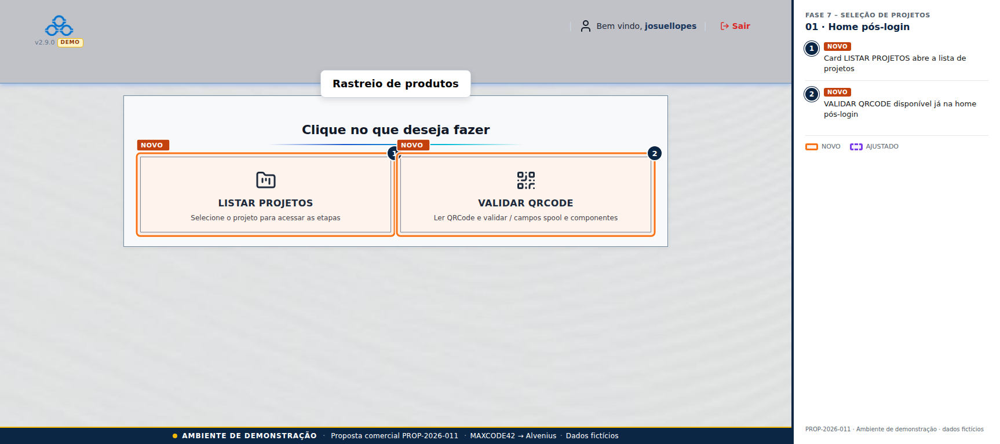 · [mobile](prints/fase-1/01-home-projetos-mobile.png) | ① NOVO card LISTAR PROJETOS · ② NOVO VALIDAR QRCODE na home |
| 02 | 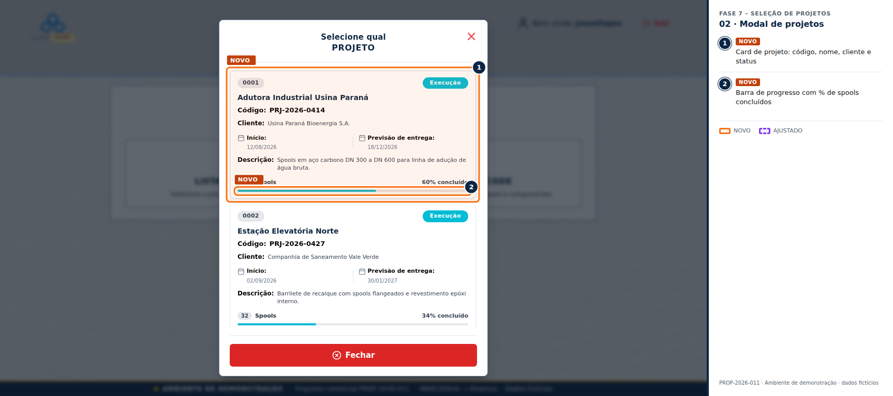 · [mobile](prints/fase-1/02-modal-projetos-mobile.png) | ① NOVO card de projeto (código, nome, cliente, status) · ② NOVO barra de progresso (% spools) |
| 03 | 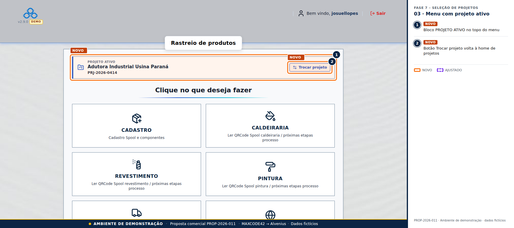 · [mobile](prints/fase-1/03-menu-projeto-ativo-mobile.png) | ① NOVO bloco PROJETO ATIVO · ② NOVO botão Trocar projeto |
| 04 | 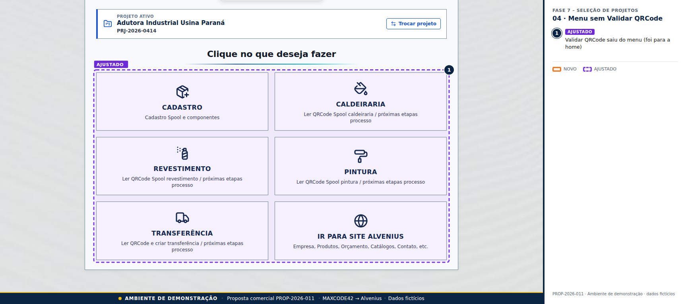 · [mobile](prints/fase-1/04-menu-sem-validar-qrcode-mobile.png) | ① AJUSTADO Validar QRCode saiu do menu (foi para a home) |
| 05 | [mobile](prints/fase-1/05-drawer-trocar-projeto-mobile.png) *(complemento incluso, 0 h)* | ① INCLUSO projeto ativo no menu lateral · ② INCLUSO item TROCAR PROJETO |
| 06 | [mobile](prints/fase-1/06-drawer-home-trocar-projeto-mobile.png) *(complemento incluso, 0 h)* | ① INCLUSO projeto ativo no menu lateral da home · ② INCLUSO atalho TROCAR PROJETO |

> 📊 *Espaço reservado: fluxo Login → Seleção → Projeto ativo → Menu* — **Destacar as etapas novas**

**Reaproveitado × Novo × Ajustado por disciplina**

| Disciplina | Reaproveitado (sem custo / subtraído) | Novo | Ajustado |
|---|---|---|---|
| **Backend** (NodeJS) | Autenticação/sessão com login em PostgreSQL; cliente HTTP da API externa e padrão de tratamento; estrutura de rotas | `GET /api/projects` (busca na API externa, normaliza e calcula contador de spools); `GET /api/projects/:id` (valida projeto ativo) | Endpoints dos módulos passam a receber/filtrar por `projectId` |
| **Frontend** (NextJS/React/Tailwind) | Layout/cards do menu (`module-card`); card de spool como base do card de projeto; padrão de modal; header; sessão e consumo da API | Tela inicial pós-login (2 opções); modal Listar Projetos; faixa de projeto ativo + Trocar projeto | Menu sem Validar QRCode; redirecionamento pós-login; projeto ativo na sessão (logout limpa); chamadas com `projectId` |
| **Designer** | Design system, cores, ícones, cards e modal existentes | Layout da tela de seleção, do modal de projetos e da faixa de projeto | Menu atual com faixa de projeto e sem Validar QRCode |
| **Database** (PostgreSQL) | Tabelas de usuários/login | — (sem persistência nesta fase) | Sem alteração: dados de projetos consumidos da API externa, tratados no backend e fornecidos via API |
| **Testes** (desenvolvimento) | Estrutura de testes existente | Testes do endpoint de projetos e dos componentes de seleção | Testes dos módulos impactados por `projectId` |

**Matriz de correlação — Cenário A + B** (reaproveita login, menu, cards, modal, design system e cliente da API externa; exige alteração no menu, no fluxo pós-login e nos módulos para uso de `projectId`; não é independente).

| Área | Do zero | Reaproveitado | Ajustes | Horas | Valor (R$) | Validação |
|---|---:|---:|---:|---:|---:|---|
| Backend | 9 h | −3 h | +2 h | 8 h | 720,00 | estimado pelo comercial |
| Frontend | 16 h | −5 h | +2 h | 13 h | 1.170,00 | estimado pelo comercial |
| Designer | 5 h | −3 h | +1 h | 3 h | 270,00 | estimado pelo comercial |
| Database *(sem persistência nesta fase)* | 0 h | 0 h | 0 h | 0 h | 0,00 | estimado pelo comercial |
| Testes (desenvolvimento) | 4 h | −1 h | +1 h | 4 h | 360,00 | estimado pelo comercial |
| **Subtotal desenvolvimento** | **34 h** | **−12 h** | **+6 h** | **28 h** | **R$ 2.520,00** | |

*Índice de reaproveitamento: 35% (12 h de 34 h base).*

**Testes, Ajustes e Deploy para produção (em separado)**

| Item | Horas | Valor (R$) | Validação |
|---|---:|---:|---|
| Testes (homologação, E2E e regressão dos módulos) | 4 h | 360,00 | estimado pelo comercial |
| Ajustes (correções pós-homologação) | 3 h | 270,00 | estimado pelo comercial |
| Deploy para produção (backend e frontend) | 2 h | 180,00 | estimado pelo comercial |
| **TOTAL Testes/Ajustes/Deploy** | **9 h** | **R$ 810,00** | |

| Horas | Prazo | Investimento |
|---|---|---|
| 37 h (28 h desenv. + 9 h testes/ajustes/deploy) | 4,625 dias úteis (~1 semana) | **R$ 3.330,00** |

> Premissas: backend estimado pelo comercial com base no escopo inicial e no código do repositório real (NodeJS + PostgreSQL); a **Alvenius é responsável por disponibilizar no Protheus o endpoint de projetos (lista com os campos exibidos e contador de spools) e o filtro por projeto** nos endpoints existentes — fora do escopo desta proposta; sem persistência em banco nesta fase — projeto ativo apenas na sessão.

---

### 4.7 Fase 9 – Vincular Cadastro ao Projeto · **NOVA FUNCIONALIDADE**

**Objetivo de negócio e problema resolvido**
Garantir que todo spool/componente cadastrado pertença ao projeto ativo, exibindo o projeto em cards, na leitura de QRCode e na validação, com listas sempre filtradas pelo projeto.

**Como funciona na prática**
1. Com o projeto ativo selecionado (Fase 7), o usuário abre o Cadastro.
2. A modal de leitura de QRCode exibe no topo o **projeto ativo**; o spool/componente lido é cadastrado já vinculado a ele.
3. O backend envia o código do projeto ao Protheus junto com o cadastro (sem gravação em banco local).
4. Os cards de spool/componente exibem um **badge com código + nome do projeto**; as listas mostram apenas itens do projeto ativo.
5. Em **Validar QRCode**, o sistema mostra o projeto ao qual o spool pertence.
6. Sem projeto ativo, o usuário é redirecionado para a seleção de projetos.

**Telas e exemplos visuais (prints com destaque obrigatório)**
| # | Print (desktop · [mobile]) | Destaques |
|---|---|---|
| 01 | 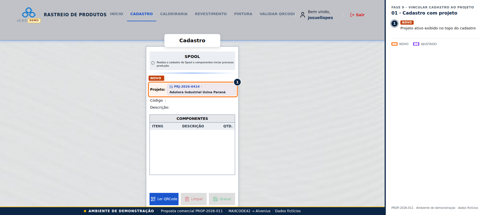 · [mobile](prints/fase-2/01-cadastro-tag-projeto-mobile.png) | ① NOVO projeto ativo no topo do cadastro |
| 02 | 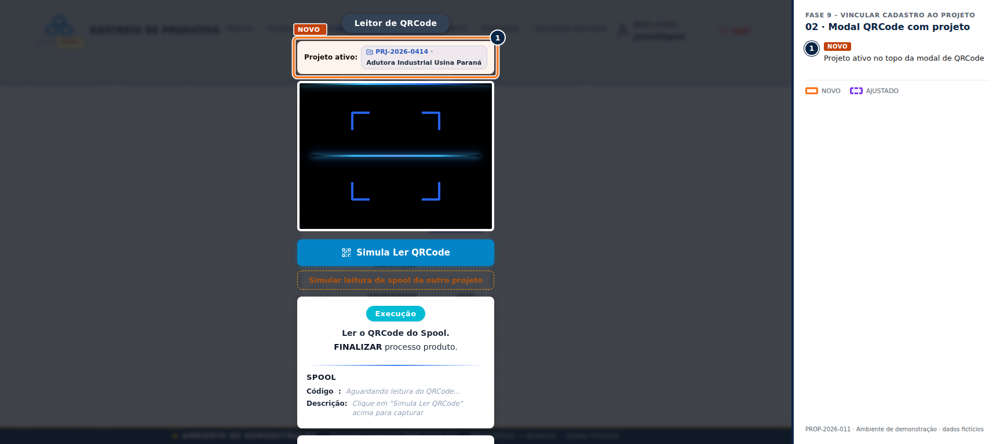 · [mobile](prints/fase-2/02-modal-qrcode-projeto-ativo-mobile.png) | ① NOVO projeto ativo no topo da modal QRCode |
| 03 | 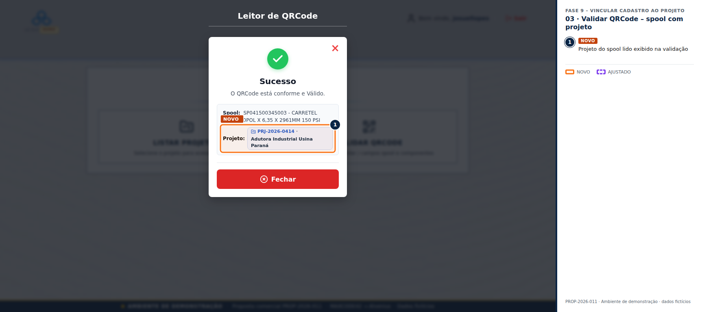 · [mobile](prints/fase-2/03-validar-qrcode-projeto-spool-mobile.png) | ① NOVO projeto do spool lido na validação |
| 04 | 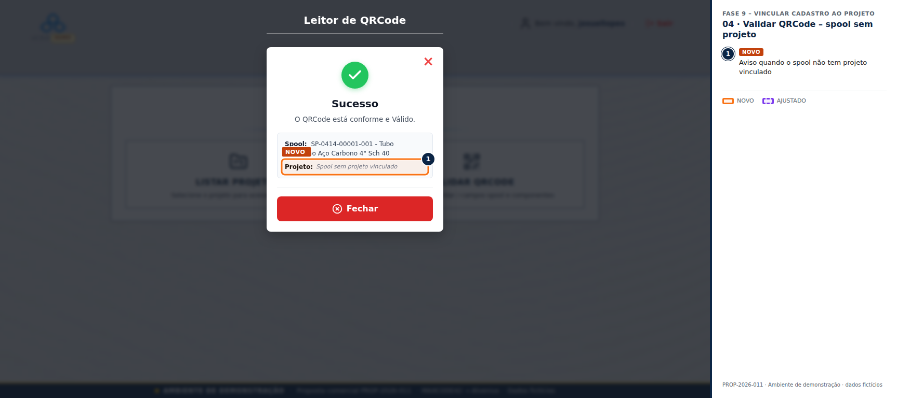 · [mobile](prints/fase-2/04-validar-qrcode-spool-sem-projeto-mobile.png) | ① NOVO aviso "Spool sem projeto vinculado" |
| 05 | 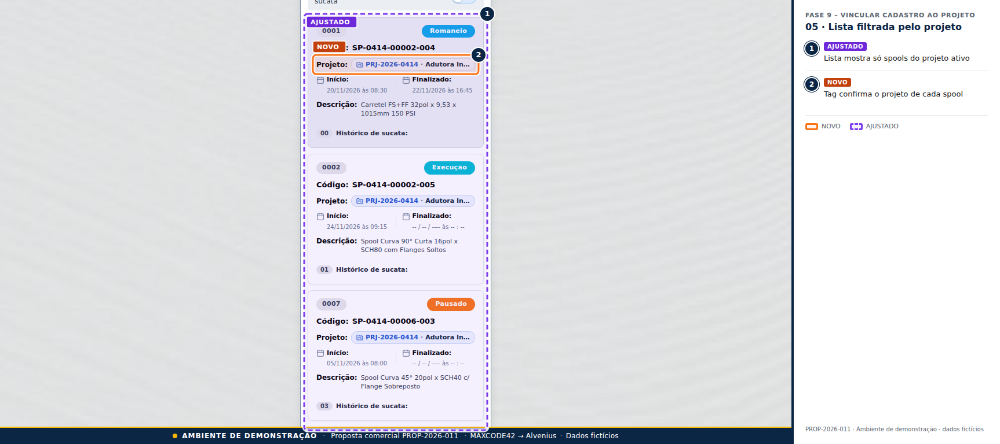 · [mobile](prints/fase-2/05-lista-filtrada-projeto-mobile.png) | ① AJUSTADO lista só do projeto ativo · ② NOVO tag do projeto no card |
| 06 | 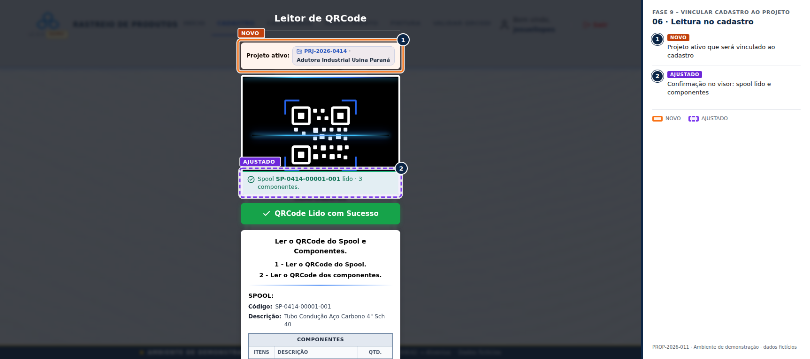 · [mobile](prints/fase-2/06-modal-cadastro-leitura-projeto-mobile.png) | ① NOVO projeto ativo vinculado ao cadastro · ② AJUSTADO confirmação no visor (spool lido · componentes) |
| 07 | 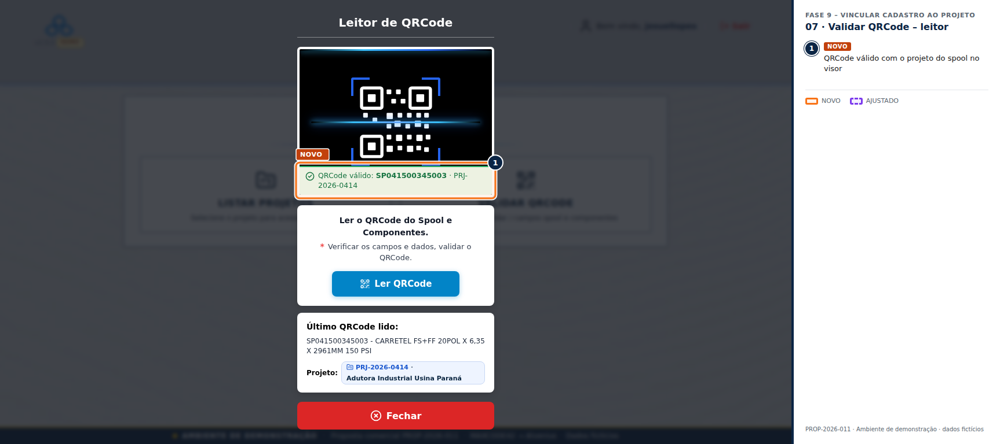 · [mobile](prints/fase-2/07-validar-leitor-sucesso-projeto-mobile.png) | ① NOVO QRCode válido com o projeto do spool no visor |

> Prints 02 e 05 recapturados após as Fases 11–12, somente com as marcações das Fases 9–10.

> 📊 *Espaço reservado: fluxo Cadastro → Protheus com vínculo* — **Destacar envio do código do projeto no payload**

**Reaproveitado × Novo × Ajustado por disciplina**

| Disciplina | Reaproveitado (sem custo / subtraído) | Novo | Ajustado |
|---|---|---|---|
| **Backend** (NodeJS) | Sessão/token Protheus e padrão next-connect; provider Protheus; filtro por projeto e `/api/v1/project` (Fase 7) | Rejeitar cadastro sem projeto ativo (400) | `models/register.js` envia o projeto no payload; parse de spool/componente inclui projeto; `component/[code]` retorna o projeto |
| **Frontend** (NextJS/React/Tailwind) | Contexto, guard e faixa de projeto (Fase 7); card/badge de projeto; modais `qr-code-*`; cards de spool | Badge de projeto nos cards; cabeçalho de projeto na modal QRCode; bloco "Projeto do spool" | `process-register` envia o projeto; `validates-qrcode` exibe o projeto; listas filtradas; guard → seleção |
| **Designer** | Faixa e card de projeto da Fase 7; design system | Badge no card; cabeçalho na modal QRCode | Validar QRCode com bloco de projeto |
| **Database** (PostgreSQL) | Tabelas de usuários/sessões | — | Sem alteração: vínculo gravado e consultado no Protheus |
| **Testes** (desenvolvimento) | Mocks Protheus; testes de register/component; mocks de projetos (Fase 7) | Caso de cadastro sem projeto | Testes de register e component validam o projeto |

**Inventário real do MVP (frontend) — ajuste fino**

| Tipo | Itens |
|---|---|
| Novo | `components/project-tag.js` (badge em cards, cadastro, modal e validação); guard de rotas `PROJECT_ROUTES`; faixa "Projeto ativo" na modal QRCode + lookup do projeto do spool no Validar; gravação do cadastro com projeto + bloqueio de duplicidade |
| Reaproveitado | `spool-card`; `process-stage-view` (filtro/busca); cards da modal QRCode; toast; `getActiveProject`/`getProjectRef` (Fase 7) |
| Ajustado | `spools-mock` (projetoId, getSpoolsByProject, addSpool); `modal-qrcode` (payload com projeto); `process-stage-view` (filtro + empty state); CSS (components/modals/views) |
| Fora | Contadores do menu por projeto; projeto nos cards de transferência |

> Resultado do ajuste fino: horas **mantidas** (itens novos compensados pelo reaproveitamento; itens fora excluídos).

**Matriz de correlação — Cenário A + B** (reaproveita da Fase 7 contexto, guard, faixa, card de projeto, endpoint e filtro; altera cadastro, modais de QRCode, cards e Validar QRCode). **Depende da Fase 7.**

| Área | Do zero | Reaproveitado | Ajustes | Horas | Valor (R$) | Validação |
|---|---:|---:|---:|---:|---:|---|
| Backend | 7 h | −3 h | +2 h | 6 h | 540,00 | estimado pelo comercial |
| Frontend | 14 h | −5 h | +2 h | 11 h | 990,00 | estimado pelo comercial |
| Designer | 4 h | −2 h | 0 h | 2 h | 180,00 | estimado pelo comercial |
| Database *(sem persistência)* | 0 h | 0 h | 0 h | 0 h | 0,00 | estimado pelo comercial |
| Testes (desenvolvimento) | 4 h | −1 h | +1 h | 4 h | 360,00 | estimado pelo comercial |
| **Subtotal desenvolvimento** | **29 h** | **−11 h** | **+5 h** | **23 h** | **R$ 2.070,00** | |

*Índice de reaproveitamento: 38% (11 h de 29 h base).*

**Testes, Ajustes e Deploy para produção (em separado)**

| Item | Horas | Valor (R$) | Validação |
|---|---:|---:|---|
| Testes (homologação, E2E e regressão do cadastro e módulos) | 3 h | 270,00 | estimado pelo comercial |
| Ajustes (correções pós-homologação) | 2 h | 180,00 | estimado pelo comercial |
| Deploy para produção | 2 h | 180,00 | estimado pelo comercial |
| **TOTAL Testes/Ajustes/Deploy** | **7 h** | **R$ 630,00** | |

| Horas | Prazo | Investimento |
|---|---|---|
| 30 h (23 h desenv. + 7 h testes/ajustes/deploy) | 3,75 dias úteis | **R$ 2.700,00** |

> Premissas: estimativa do comercial com base no escopo inicial e no código do repositório real (`models/register.js`, `pages/api/v1/register`, `components/container/process-register`, `components/ui/modal/qr-code-*`, `components/ui/card-item`, `pages/validates-qrcode`); a **Alvenius é responsável por o Protheus aceitar o código do projeto no cadastro e retorná-lo nas consultas de spool/componente** — fora do escopo; sem persistência em banco local; horas sujeitas a ajuste fino após inventário real do MVP pelo frontend.

---

### 4.8 Fase 11 – Vincular Etapas (Caldeiraria, Revestimento, Pintura) ao Projeto · **NOVA FUNCIONALIDADE**

**Objetivo de negócio e problema resolvido**
Garantir que as movimentações de Caldeiraria, Revestimento e Pintura ocorram somente para spools do projeto ativo, com contadores por projeto e bloqueio de spools de outro projeto.

**Como funciona na prática**
1. Com o projeto ativo (Fase 7), o usuário abre uma etapa (Caldeiraria, Revestimento ou Pintura).
2. O topo da etapa exibe a faixa **"Projeto ativo"** e os contadores passam a considerar apenas o projeto.
3. Na leitura de QRCode da etapa, a modal mostra o projeto ativo no topo.
4. Se o spool lido for de **outro projeto**, a ação é bloqueada: aviso com o projeto do spool, toast e botão desabilitado.
5. Ao avançar o status, a movimentação é enviada ao Protheus com o código do projeto (sem gravação em banco local).
6. Sem projeto ativo, a etapa redireciona para a seleção de projetos.

**Telas e exemplos visuais (prints com destaque obrigatório)**
| # | Print (desktop · [mobile]) | Destaques |
|---|---|---|
| 01 | 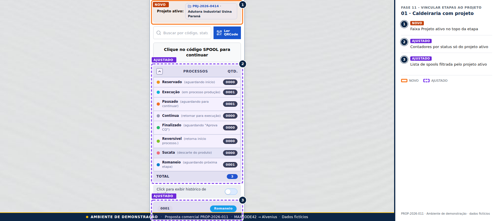 · [mobile](prints/fase-3/01-caldeiraria-projeto-mobile.png) · [mobile 2](prints/fase-3/01-caldeiraria-projeto-mobile-2.png) | ① NOVO faixa Projeto ativo · ② AJUSTADO contadores do projeto · ③ AJUSTADO lista filtrada |
| 02 |  · [mobile](prints/fase-3/02-revestimento-projeto-mobile.png) · [mobile 2](prints/fase-3/02-revestimento-projeto-mobile-2.png) | Mesmos destaques de 01 |
| 03 | 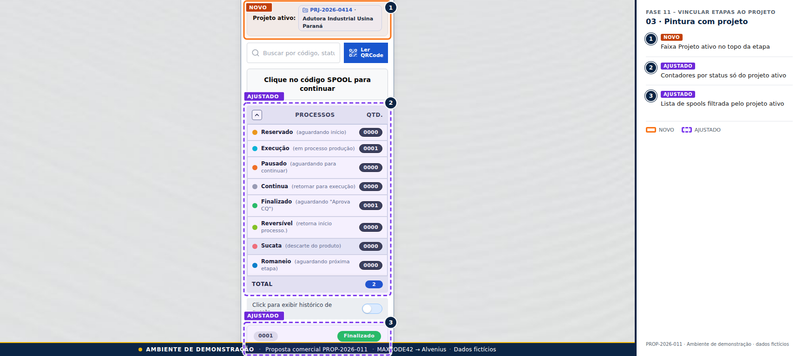 · [mobile](prints/fase-3/03-pintura-projeto-mobile.png) · [mobile 2](prints/fase-3/03-pintura-projeto-mobile-2.png) | Mesmos destaques de 01 |
| 04 | 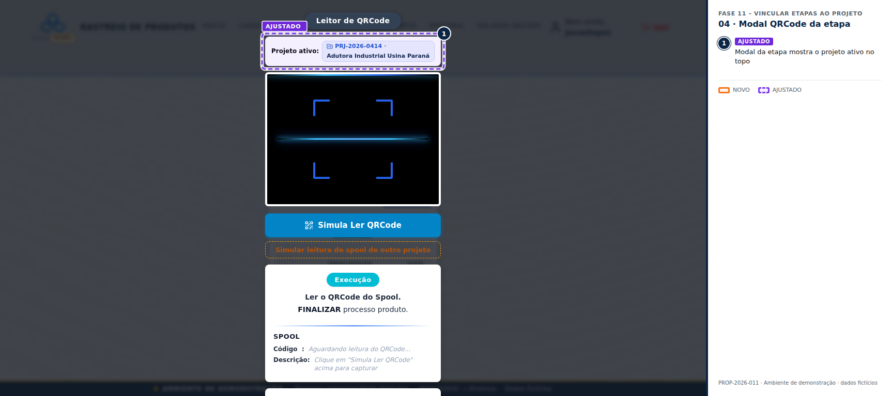 · [mobile](prints/fase-3/04-modal-qrcode-etapa-projeto-mobile.png) | ① AJUSTADO projeto ativo no topo da modal da etapa |
| 05 | 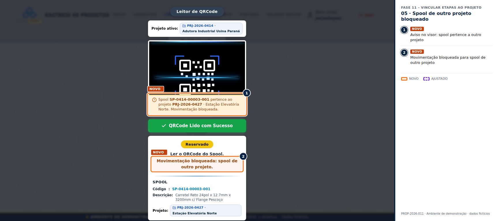 · [mobile](prints/fase-3/05-spool-outro-projeto-bloqueado-mobile.png) | ① NOVO aviso no visor: spool de outro projeto · ② NOVO movimentação bloqueada |
| 06 | 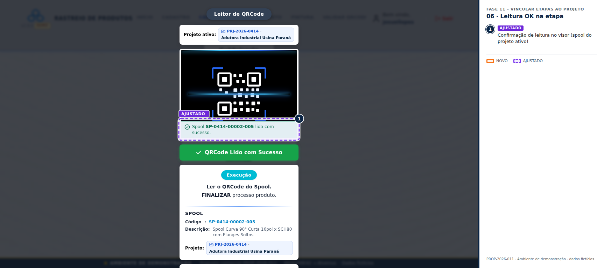 · [mobile](prints/fase-3/06-leitura-ok-etapa-projeto-mobile.png) | ① AJUSTADO confirmação de leitura no visor |

> 📊 *Espaço reservado: fluxo Etapa → Protheus com projeto na movimentação* — **Destacar validação spool×projeto**

**Reaproveitado × Novo × Ajustado por disciplina**

| Disciplina | Reaproveitado (sem custo / subtraído) | Novo | Ajustado |
|---|---|---|---|
| **Backend** (NodeJS) | Sessão/token Protheus e next-connect (`pages/api/v1/boilermaking\|coating\|painting`); provider/adapters Protheus; projeto do spool (Fase 9) e filtro por projeto (Fase 7) | Validação spool×projeto ativo nas rotas de etapa (409 com o projeto do spool) | `models/boilermaking.js`, `coating.js`, `painting.js` enviam o projeto na movimentação; contadores por projeto |
| **Frontend** (NextJS/React/Tailwind) | `ProjectTag`; `getProjectRef`/`getActiveProject`; tag nos cards (Fase 9); `getSpoolsByProject`; `ProcessesAccordion`; toasts | `getCountersByProject`; faixa "Projeto ativo" em cada etapa; bloqueio de spool de outro projeto (aviso + toast + ação desabilitada) + guard extra em `ProcessStageView`; `updateSpoolStatus` grava o projeto | `process-stage-view` (contadores + projeto na movimentação); `modal-qrcode` (topo com projeto no modo etapa); CSS modals/views |
| **Designer** | Faixa e tag de projeto (Fases 7–10); cards e modal QRCode | Estado de bloqueio "spool de outro projeto" | Topo das etapas com faixa e contadores |
| **Database** (PostgreSQL) | Tabelas de usuários/sessões | — | Sem alteração: validação e movimentação no Protheus |
| **Testes** (desenvolvimento) | Testes unit/integration das 3 etapas; mocks Protheus e de projetos | Caso spool de outro projeto bloqueado (409) | Testes das 3 etapas validam projeto e contadores |

**Matriz de correlação — Cenário A + B** (reaproveita das Fases 7–10 tag, helpers, projeto do spool e filtro; altera `process-stage-view`, `modal-qrcode` e os models das 3 etapas). As 3 etapas compartilham componente e models de mesmo padrão, por isso o custo não triplica. **Depende das Fases 1 e 2.**

| Área | Do zero | Reaproveitado | Ajustes | Horas | Valor (R$) | Validação |
|---|---:|---:|---:|---:|---:|---|
| Backend | 8 h | −3 h | +2 h | 7 h | 630,00 | estimado pelo comercial |
| Frontend | 14 h | −5 h | +2 h | 11 h | 990,00 | estimado pelo comercial |
| Designer | 4 h | −2 h | +1 h | 3 h | 270,00 | estimado pelo comercial |
| Database *(sem persistência)* | 0 h | 0 h | 0 h | 0 h | 0,00 | estimado pelo comercial |
| Testes (desenvolvimento) | 5 h | −2 h | +1 h | 4 h | 360,00 | estimado pelo comercial |
| **Subtotal desenvolvimento** | **31 h** | **−12 h** | **+6 h** | **25 h** | **R$ 2.250,00** | |

*Índice de reaproveitamento: 39% (12 h de 31 h base).*

**Testes, Ajustes e Deploy para produção (em separado)**

| Item | Horas | Valor (R$) | Validação |
|---|---:|---:|---|
| Testes (homologação, E2E e regressão das 3 etapas) | 4 h | 360,00 | estimado pelo comercial |
| Ajustes (correções pós-homologação) | 2 h | 180,00 | estimado pelo comercial |
| Deploy para produção | 2 h | 180,00 | estimado pelo comercial |
| **TOTAL Testes/Ajustes/Deploy** | **8 h** | **R$ 720,00** | |

| Horas | Prazo | Investimento |
|---|---|---|
| 33 h (25 h desenv. + 8 h testes/ajustes/deploy) | 4,125 dias úteis | **R$ 2.970,00** |

> Premissas: estimativa do comercial com base no escopo inicial e no código do repositório real (`models/boilermaking.js`, `coating.js`, `painting.js`, `pages/api/v1/boilermaking|coating|painting`, `components/container/process-flow`, `tests/unit|integration/api/v1/*`) e no inventário real do frontend; a **Alvenius é responsável por o Protheus aceitar o projeto nas movimentações e retornar o projeto do spool** — fora do escopo; sem persistência em banco local; fora: projeto nos cards de transferência.

---

### 4.9 Fase 13 – Vincular Projeto ao Fluxo de Transferência · **NOVA FUNCIONALIDADE**

**Objetivo de negócio e problema resolvido**
Garantir que as transferências sejam registradas e acompanhadas por projeto, com listas e contadores do projeto ativo e bloqueio de itens de outro projeto.

**Como funciona na prática**
1. Com o projeto ativo (Fase 7), o usuário abre **Transferência**.
2. As listas exibem a faixa **"Projeto ativo"** e os contadores **Em Trânsito / Concluído / Total** somente do projeto; sem itens, aparece o empty state do projeto.
3. Na **nova transferência**, a faixa mostra o projeto ativo e os itens lidos por QRCode recebem o projeto.
4. Se o item lido for de **outro projeto**, a inclusão é bloqueada: alerta (spool/componente) com o projeto dele e toast.
5. Ao gravar, a transferência é enviada ao Protheus com o código do projeto e validada (sem gravação em banco local).
6. A conclusão (Em Trânsito → Concluído) e o detalhe seguem na API Protheus ADVPL do cliente.

**Telas e exemplos visuais (prints com destaque obrigatório)**
| # | Print (desktop · [mobile]) | Destaques |
|---|---|---|
| 01 | 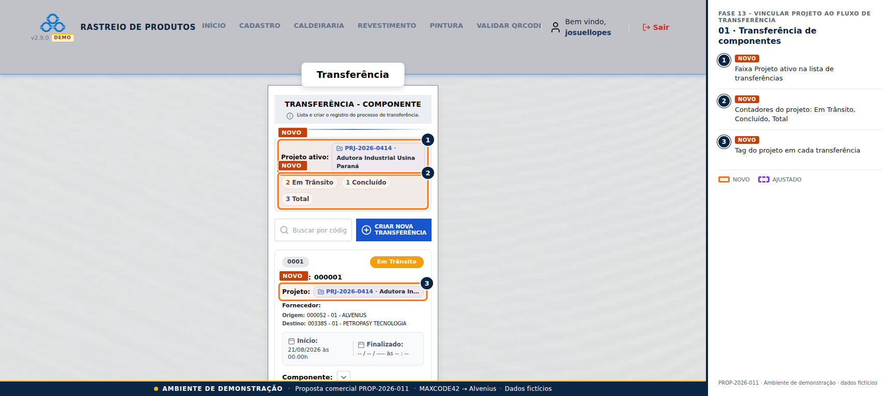 · [mobile](prints/fase-4/01-transf-componente-projeto-mobile.png) | ① NOVO faixa Projeto ativo · ② NOVO contadores Em Trânsito/Concluído/Total · ③ NOVO tag do projeto |
| 02 | 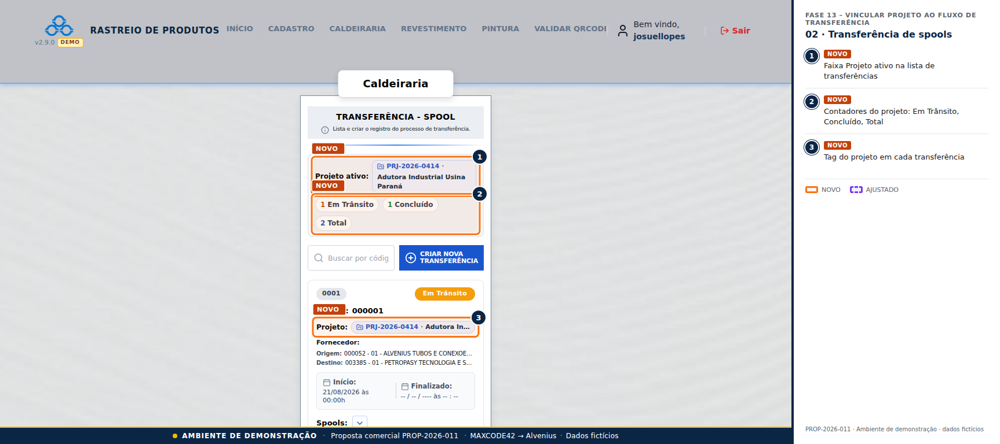 · [mobile](prints/fase-4/02-transf-spool-projeto-mobile.png) | Mesmos destaques de 01 |
| 03 | 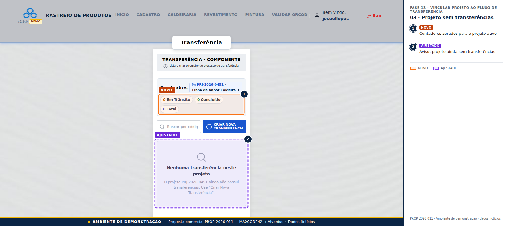 · [mobile](prints/fase-4/03-transf-componente-sem-transferencias-mobile.png) | ① NOVO contadores zerados · ② AJUSTADO aviso de projeto sem transferências |
| 04 | 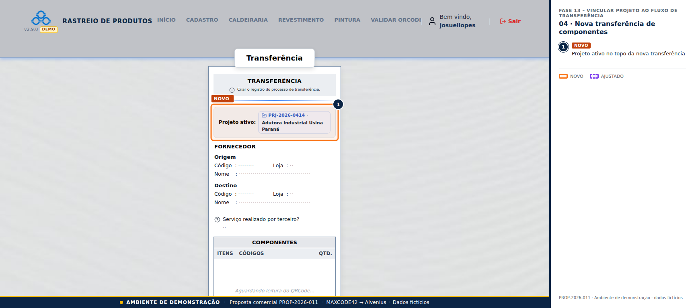 · [mobile](prints/fase-4/04-nova-transf-componente-projeto-mobile.png) | ① NOVO projeto ativo no topo |
| 05 | 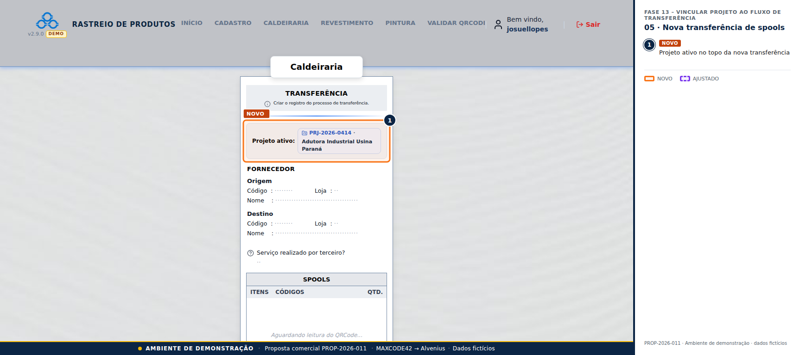 · [mobile](prints/fase-4/05-nova-transf-spool-projeto-mobile.png) | ① NOVO projeto ativo no topo |
| 06 | 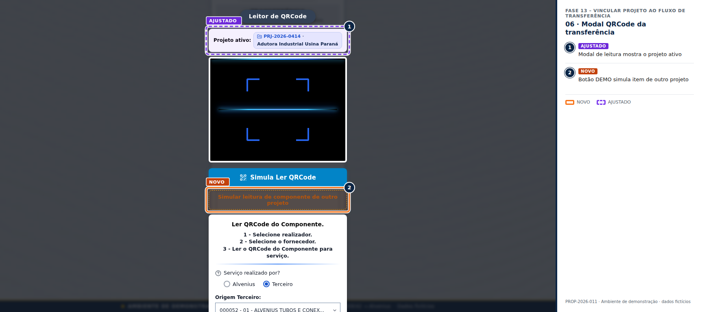 · [mobile](prints/fase-4/06-modal-qrcode-transf-projeto-mobile.png) | ① AJUSTADO projeto ativo na modal · ② NOVO botão DEMO de item de outro projeto |
| 07 | 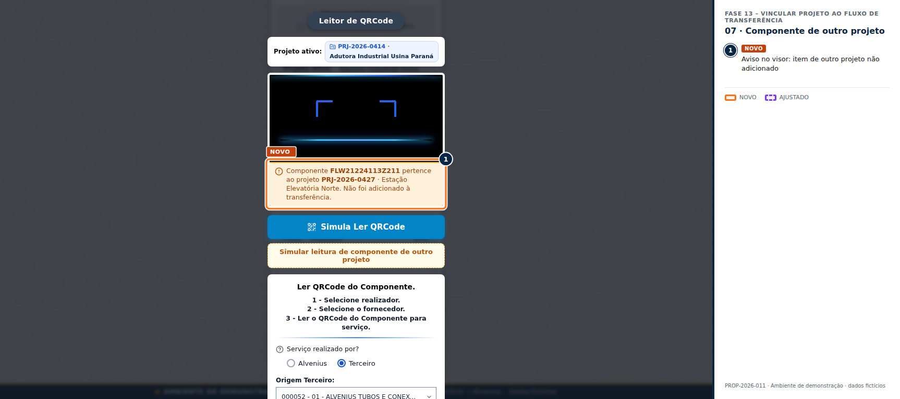 · [mobile](prints/fase-4/07-transf-componente-outro-projeto-mobile.png) | ① NOVO aviso no visor: item de outro projeto não adicionado |
| 08 | 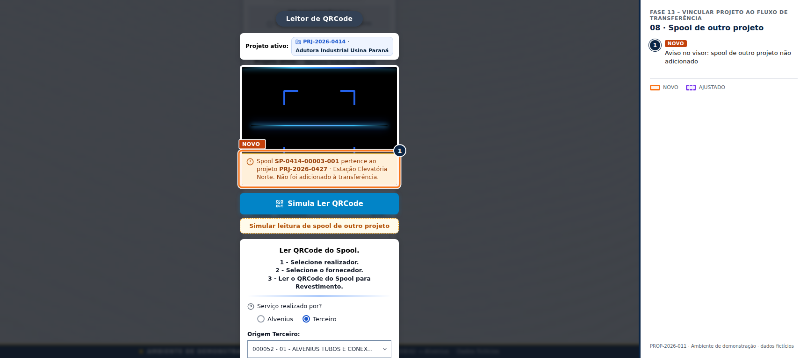 · [mobile](prints/fase-4/08-transf-spool-outro-projeto-mobile.png) | ① NOVO aviso no visor: spool de outro projeto não adicionado |
| 09 | 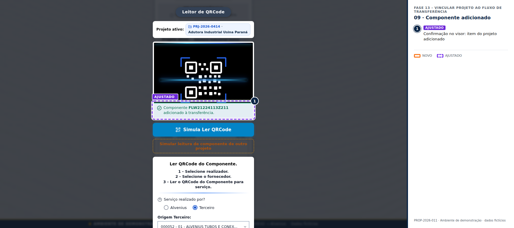 · [mobile](prints/fase-4/09-transf-componente-item-adicionado-mobile.png) | ① AJUSTADO confirmação no visor: item adicionado |
| 10 | 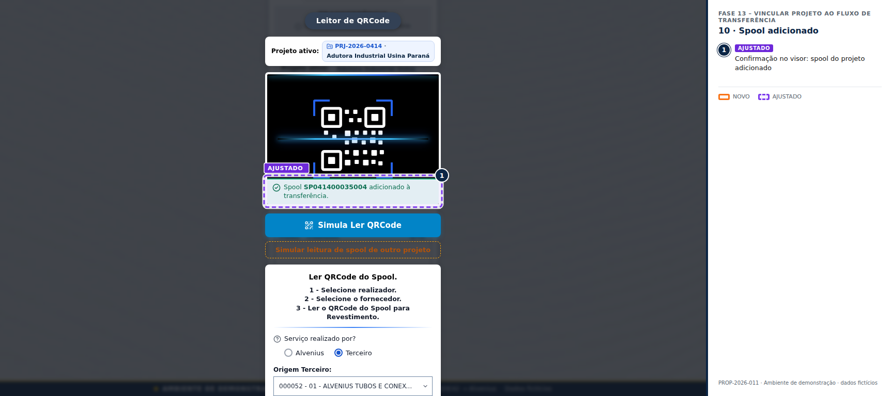 · [mobile](prints/fase-4/10-transf-spool-item-adicionado-mobile.png) | ① AJUSTADO confirmação no visor: spool adicionado |

> 📊 *Espaço reservado: fluxo Transferência → Protheus com projeto* — **Destacar envio e validação do projeto**

**Reaproveitado × Novo × Ajustado por disciplina**

| Disciplina | Reaproveitado (sem custo / subtraído) | Novo | Ajustado |
|---|---|---|---|
| **Backend** (NodeJS) | Sessão/token Protheus e next-connect (`pages/api/v1/transfer/[process]`, `supplier/[process]`); provider/adapters Protheus; validação item×projeto (padrão Fase 11) e filtro por projeto (Fase 7) | Contadores Em Trânsito/Concluído/Total por projeto; item de outro projeto rejeitado (409) | `models/transfer.js` envia o projeto na gravação; listas de `transfer`/`supplier` filtradas por projeto |
| **Frontend** (NextJS/React/Tailwind) | `ProjectTag`; `getActiveProject`/`getProjectRef`; guard `PROJECT_ROUTES` (já cobria transferências); visual/toast "outro projeto" (Fase 11); payload da modal com projeto (Fase 9) | Vínculo do projeto nas transferências; filtro por projeto; contadores por projeto; faixa + contadores nas listas; empty state por projeto; faixa na nova transferência; alerta de item de outro projeto (bloqueio, toast, demo) | Gravação envia projeto + valida; itens lidos recebem projeto; limpeza do alerta; texto spool/componente no alerta |
| **Designer** | Faixa e tag de projeto (Fases 7–9); alerta "outro projeto" (Fase 11) | Contadores de transferência por projeto; empty state por projeto | Listas e nova transferência com faixa de projeto |
| **Database** (PostgreSQL) | Tabelas de usuários/sessões | — | Sem alteração: vínculo e validação no Protheus |
| **Testes** (desenvolvimento) | Testes integration de `transfer/[process]` (get/post) e `supplier`; mocks Protheus e de projetos | Caso item de outro projeto bloqueado (409) | Testes de transfer validam projeto, filtro e contadores |

**Matriz de correlação — Cenário A + B** (reaproveita das Fases 7–11 tag, helpers, guard, alerta "outro projeto" e payload com projeto; altera gravação e listas de transferência). **Depende das Fases 7, 9 e 11.**

| Área | Do zero | Reaproveitado | Ajustes | Horas | Valor (R$) | Validação |
|---|---:|---:|---:|---:|---:|---|
| Backend | 8 h | −3 h | +2 h | 7 h | 630,00 | estimado pelo comercial |
| Frontend | 16 h | −6 h | +2 h | 12 h | 1.080,00 | estimado pelo comercial |
| Designer | 4 h | −2 h | +1 h | 3 h | 270,00 | estimado pelo comercial |
| Database *(sem persistência)* | 0 h | 0 h | 0 h | 0 h | 0,00 | estimado pelo comercial |
| Testes (desenvolvimento) | 5 h | −2 h | +1 h | 4 h | 360,00 | estimado pelo comercial |
| **Subtotal desenvolvimento** | **33 h** | **−13 h** | **+6 h** | **26 h** | **R$ 2.340,00** | |

*Índice de reaproveitamento: 39% (13 h de 33 h base).*

**Testes, Ajustes e Deploy para produção (em separado)**

| Item | Horas | Valor (R$) | Validação |
|---|---:|---:|---|
| Testes (homologação, E2E e regressão de transferências) | 4 h | 360,00 | estimado pelo comercial |
| Ajustes (correções pós-homologação) | 2 h | 180,00 | estimado pelo comercial |
| Deploy para produção | 2 h | 180,00 | estimado pelo comercial |
| **TOTAL Testes/Ajustes/Deploy** | **8 h** | **R$ 720,00** | |

| Horas | Prazo | Investimento |
|---|---|---|
| 34 h (26 h desenv. + 8 h testes/ajustes/deploy) | 4,25 dias úteis | **R$ 3.060,00** |

> Premissas: estimativa do comercial com base no escopo inicial e no código do repositório real (`models/transfer.js`, `models/supplier.js`, `pages/api/v1/transfer/[process]`, `pages/api/v1/supplier/[process]`, `components/container/process-transfer/*`, `tests/integration/api/v1/transfer|supplier`) e no inventário real do frontend; sem persistência em banco local; **fora do escopo:** conclusão de transferência (Em Trânsito → Concluído) e detalhe — responsabilidade da API externa Protheus ADVPL do cliente; a Alvenius é responsável por o Protheus aceitar e retornar o projeto nas transferências.

---

## 5. Quadro Consolidado de Investimento e Cronograma

| Fase | Etapa | Horas | Prazo (dias úteis) | Valor (R$) |
|---|---|---:|---:|---:|
| 0 | Descoberta, alinhamento e design das telas *(já existente)* | 0 h | 0 | 0,00 |
| 1 | Rastreio por QR Code *(já existente)* | 0 h | 0 | 0,00 |
| 2 | Gestão de Spools e Projetos *(já existente)* | 0 h | 0 | 0,00 |
| 3 | Controle de Sucata e Retrabalho *(já existente)* | 0 h | 0 | 0,00 |
| 4 | Painel Gerencial *(já existente)* | 0 h | 0 | 0,00 |
| 5 | Integração com ERP *(já existente)* | 0 h | 0 | 0,00 |
| 6 | Homologação, treinamento e entrada em produção *(já existente)* | 0 h | 0 | 0,00 |
| 7 | **Fase 7 – Seleção de Projetos (pós-login) – desenvolvimento** | 28 h | 3,5 | 2.520,00 |
| 8 | **Testes, ajustes e deploy para produção (Seleção de Projetos)** | 9 h | 1,125 | 810,00 |
| 9 | **Fase 9 – Vincular Cadastro ao Projeto – desenvolvimento** | 23 h | 2,875 | 2.070,00 |
| 10 | **Testes, ajustes e deploy para produção (Vincular Cadastro ao Projeto)** | 7 h | 0,875 | 630,00 |
| 11 | **Fase 11 – Vincular Etapas ao Projeto – desenvolvimento** | 25 h | 3,125 | 2.250,00 |
| 12 | **Testes, ajustes e deploy para produção (Vincular Etapas ao Projeto)** | 8 h | 1 | 720,00 |
| 13 | **Fase 13 – Vincular Projeto ao Fluxo de Transferência – desenvolvimento** | 26 h | 3,25 | 2.340,00 |
| 14 | **Testes, ajustes e deploy para produção (Vincular Projeto ao Fluxo de Transferência)** | 8 h | 1 | 720,00 |
| | **TOTAL** | **134 h** | **16,75 dias úteis (~3,5 semanas)** | **R$ 12.060,00** |

**Planilha por área — Fases 0 e 6** *(já existentes; Fases 1–5 em 4.1–4.5; Fases 7–8 em 4.6; Fases 9–10 em 4.7; Fases 11–12 em 4.8; Fases 13–14 em 4.9)*

| Fase | Área | Do zero | Reaproveitado | Ajustes | Horas | Valor (R$) | Validação |
|---|---|---:|---:|---:|---:|---:|---|
| 0 | Backend · Frontend · Designer · Database · Testes | 0 h | 0 h | 0 h | 0 h | 0,00 | já existente |
| 6 | Backend · Frontend · Designer · Database · Testes | 0 h | 0 h | 0 h | 0 h | 0,00 | já existente |

**Consolidado Testes / Ajustes / Deploy (novas funcionalidades):** Testes 15 h (R$ 1.350,00) · Ajustes 9 h (R$ 810,00) · Deploy 8 h (R$ 720,00) · **Total 32 h (R$ 2.880,00)**.

**Entregas por sprint (2 semanas):**

| Sprint | Conteúdo | Dias úteis | Período |
|---|---|---:|---|
| 1 | Fase 0 + Fase 1 *(já existentes)* | 0 | — |
| 2 | Fase 2 *(já existente)* | 0 | — |
| 3 | Fases 3 e 4 *(já existentes)* | 0 | — |
| 4 | Fase 5 + Fase 6 *(já existentes)* | 0 | — |
| 5 | Fases 7 e 8 — Seleção de Projetos | 4,625 | 01/12/2026 a 07/12/2026 |
| 6 | Fases 9 e 10 — Vincular Cadastro ao Projeto | 3,75 | 07/12/2026 a 11/12/2026 |
| 7 | Fases 11 e 12 — Vincular Etapas ao Projeto | 4,125 | 11/12/2026 a 17/12/2026 |
| 8 | Fases 13 e 14 — Vincular Projeto ao Fluxo de Transferência | 4,25 | 17/12/2026 a 23/12/2026 |

**Condições de pagamento (parcelas quinzenais, dias corridos a partir do início em 01/12/2026):**

| Parcela | Vencimento | Data | % | Valor (R$) |
|---|---|---|---:|---:|
| 1ª | Na aprovação da proposta (D+0) | 01/12/2026 | 30% | 3.618,00 |
| 2ª | 15 dias após a aprovação (D+15) | 16/12/2026 | 40% | 4.824,00 |
| 3ª | 30 dias após a aprovação (D+30) | 31/12/2026 | 30% | 3.618,00 |
| | **Total** | | **100%** | **R$ 12.060,00** |

> Marcos da proposta original (aprovação / Sprint 2 / homologação final) estão **substituídos** pelos marcos acima, aguardando decisão do cliente.

---

## 6. Pós-Entrega, Homologação e Novas Demandas

### 6.1 Homologação
- A Alvenius testa cada entrega e aprova por escrito (e-mail ou ata).
- Prazo de resposta de homologação: até **5 dias úteis** por entrega.
- O que for aprovado passa a ser o **escopo homologado**.

### 6.2 Garantia e Suporte
- **90 dias corridos** de acompanhamento após a entrada em produção.
- Correção de desvios em relação ao escopo homologado **sem custo adicional**.
- Canal de suporte: e-mail e WhatsApp em horário comercial; resposta em até 1 dia útil.

### 6.3 Novas Solicitações
- Alteração ou funcionalidade fora do escopo homologado é **orçada à parte**, seguindo a **Metodologia de Estimativa e Composição de Custos** (Seção 4.0).
- Cada nova funcionalidade tem seu esforço decomposto nas 5 frentes técnicas: **Backend, Frontend, Designer, Database e Testes**.
- Aplica-se a análise de impacto:
  - **Reaproveitamento identificado:** subtrai tempo e valor correspondentes ao reúso de componentes existentes.
  - **Alterações necessárias no existente:** adiciona tempo e valor correspondentes ao retrabalho/adaptação nas funcionalidades anteriores.
  - **Sem impacto mútuo (independente):** soma tempo e valor diretamente à proposta e ao cronograma.
- Cada nova funcionalidade é entregue com seu **tempo e valor individuais**, somados ao investimento consolidado.
- Taxa hora padrão: **R$ 90,00/hora**.
- A MAXCODE42 envia estimativa de horas e prazo; **o trabalho só começa após aprovação prévia** da Alvenius.
- Não há cobrança surpresa: o valor aprovado é o valor cobrado.

---

## 7. Premissas e Fora de Escopo

**Premissas:** projeto já existente e funcional (somente novas funcionalidades são precificadas); dados de negócio via APIs externas tratadas no backend, com persistência em banco restrita ao extremamente necessário; acesso a um responsável da Alvenius para dúvidas e homologação; fornecimento de dados e acessos para a integração; internet e dispositivos (celular/tablet) no chão de fábrica; endpoint de projetos e filtro por projeto disponibilizados pela Alvenius no ERP Protheus.

**Fora de escopo:** compra de hardware (impressoras de etiqueta, leitores, tablets), hospedagem em nuvem (orçada separadamente), customizações não listadas, conteúdo de treinamento além do previsto e desenvolvimento/ajuste no ERP Protheus (endpoint de projetos e filtro por projeto — responsabilidade do cliente).

---

## 8. Aceite

| Alvenius Tubos e Conexões | MAXCODE42 |
|---|---|
| Nome: ______________________ | Josuel Lopes |
| Data: ____/____/______ | Data: ____/____/______ |
| Assinatura: __________________ | Assinatura: __________________ |

**MAXCODE42** · Código limpo, produto no centro · <https://maxcode42.com.br>

